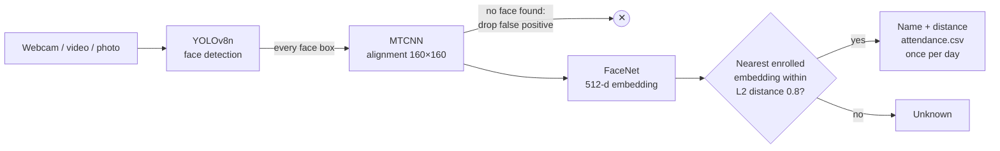

# Face Recognition Attendance System — YOLOv8 + FaceNet

[](https://github.com/mahajanp2804/Face-Recognition-using-YoloV8-and-FaceNet-main/actions/workflows/ci.yml)


A real-time face recognition system that marks attendance from a webcam, a video or a photo. YOLOv8 detects faces, MTCNN aligns them, and FaceNet (InceptionResnetV1, VGGFace2 weights) turns each face into a 512-d embedding that is matched against enrolled people.

**Features**

- Recognises **every face in the frame** and draws a labelled box with its match distance
- **15 FPS end to end on a laptop CPU** (Apple M4, 640 px frames) — see [Performance](#performance)
- Attendance log that marks each person **once per day**, in kiosk or continuous mode
- **Streamlit web app** to recognise from the camera, enroll people and browse attendance
- `facerec` command-line tool: `enroll`, `run`, `benchmark`, `evaluate`
- Built-in **accuracy evaluation**: ROC curve, AUC, equal error rate, TAR @ FAR, k-fold accuracy (LFW protocol supported)
- Installable Python package with YAML config, logging, type hints, 58 unit tests and CI

## How it works



- **Detection** — a YOLOv8n model trained for the single class *face* (`detection/weights/best.pt`).
- **Alignment** — MTCNN re-finds the face inside each YOLO crop and aligns it. It also acts as a second-stage check: boxes where MTCNN finds no face are dropped as false positives.
- **Embedding** — FaceNet maps the aligned face to a 512-d, L2-normalised vector; photos of the same person land close together.
- **Matching** — all enrolled embeddings are stacked into one matrix, so matching a face against everyone is a single vectorised NumPy operation (≈0.1 ms).

## Installation

Requires Python 3.9–3.12.

```bash
git clone https://github.com/mahajanp2804/Face-Recognition-using-YoloV8-and-FaceNet-main.git
cd Face-Recognition-using-YoloV8-and-FaceNet-main
python3 -m venv venv
source venv/bin/activate        # Windows: venv\Scripts\activate
pip install -e ".[app]"         # package + CLI + Streamlit web app
```

Run the commands below from the repository folder so `config.yaml` is picked up.

## Usage

### 1. Enroll people

Put 3–5 photos of each person in `known_faces/<Full Name>/` (see [known_faces/README.md](known_faces/README.md)), then:

```bash
python -m facerec enroll --dir known_faces
```

This writes `known_embeddings.pkl` (name → list of 512-d embeddings). Re-running updates the people in the folder and keeps everyone else. You can also enroll from the web app.

### 2. Recognise and mark attendance

```bash
python -m facerec run --source 0                 # kiosk: stop once someone is recognised
python -m facerec run --source 0 --continuous    # keep going, mark everyone who appears
python -m facerec run --source lecture.mp4 --continuous --no-window   # headless, on a video
```

`--source` is a webcam index or a video file. Every face gets a box: green with the name and distance when recognised, red when unknown. Kiosk mode marks everyone known in the first frame that has a match, then closes (or gives up after `timer_seconds`). Each person is marked at most once per day in `attendance.csv`. Press `q` to quit. `--threshold` overrides the match threshold.

### 3. Web app

```bash
streamlit run app.py
```

| Tab | What it does |
| --- | --- |
| **Recognize** | Take a photo with the browser camera or upload one; shows labelled boxes, distances, and marks attendance |
| **Enroll** | Type a name, upload photos, and the person is embedded and added straight away |
| **Attendance** | Present today, a per-day table, attendance per day chart, and CSV download |

The sidebar has a live match-threshold slider and the number of enrolled people.

### 4. Benchmark speed

```bash
python -m facerec benchmark --images known_faces --frames 200
python -m facerec benchmark --video clip.mp4 --frames 300 --json bench.json
```

Times each stage separately and prints a Markdown table (frames are resized to 640 px wide, like a webcam, unless `--width 0`).

### 5. Evaluate accuracy

```bash
python -m facerec evaluate --dataset path/to/lfw --pairs path/to/pairs.txt --roc roc.png
python -m facerec evaluate --dataset my_people/ --max-pairs 3000 --json report.json
```

`--dataset` is a folder with one sub-folder of photos per person. With LFW's `pairs.txt` it follows the standard [LFW](https://vis-www.cs.umass.edu/lfw/) verification protocol (6,000 pairs, 10-fold cross-validation); otherwise it samples balanced same-person / different-person pairs. It reports k-fold accuracy, ROC AUC, equal error rate, TAR at FAR = 1% and 0.1%, the accuracy-maximising threshold and the accuracy at your configured threshold, and can save a ROC curve plus a distance histogram.

## Performance

`python -m facerec benchmark`, 200 timed frames at 640 px, one face per frame, **CPU only** (Apple M4, PyTorch 2.14):

| Stage | Mean (ms) | p50 (ms) | p95 (ms) |
| --- | ---: | ---: | ---: |
| YOLOv8n face detection (per frame) | 25.7 | 25.3 | 29.8 |
| MTCNN alignment (per face) | 19.2 | 14.5 | 40.6 |
| FaceNet embedding (per face) | 16.8 | 16.9 | 17.6 |
| Nearest-neighbour match (per face) | 0.1 | 0.1 | 0.2 |
| **Full pipeline (per frame)** | **65.7** | **59.6** | **81.1** |

→ **15.2 FPS** end to end. On a CUDA GPU the models move to the GPU automatically.

## Configuration

[`config.yaml`](config.yaml) holds the settings; relative paths are resolved against the file's folder. Every command accepts `--config <file>` and `-v` for debug logging.

| Key | Default | Meaning |
| --- | --- | --- |
| `paths.faces_dir` | `known_faces` | Enrollment photos, one sub-folder per person |
| `paths.embeddings` | `known_embeddings.pkl` | Embeddings written by `enroll`, read by `run` and the app |
| `paths.yolo_weights` | `detection/weights/best.pt` | YOLOv8 face detector |
| `paths.attendance` | `attendance.csv` | Attendance log |
| `recognition_threshold` | `0.8` | Max L2 distance to count as a match |
| `timer_seconds` | `5` | Kiosk mode gives up after this many seconds |
| `camera_index` | `0` | Default webcam for `run` |

## Project structure

```
├── app.py                # Streamlit web app
├── src/facerec/
│   ├── cli.py            # `python -m facerec enroll | run | benchmark | evaluate`
│   ├── config.py         # loads config.yaml
│   ├── detector.py       # YOLOv8 face detection, crop + box clamping
│   ├── embedder.py       # MTCNN alignment + FaceNet 512-d embeddings
│   ├── matcher.py        # vectorised nearest-neighbour matching, embeddings load/save
│   ├── recognize.py      # multi-face recognition, drawing, live loop
│   ├── attendance.py     # once-per-day CSV attendance log
│   ├── enroll.py         # photos → embeddings
│   ├── benchmark.py      # per-stage latency + FPS
│   └── evaluation.py     # verification metrics: ROC, AUC, EER, TAR@FAR, k-fold accuracy
├── tests/                # pytest suite (no webcam, GPU or model weights needed)
├── detection/
│   ├── weights/best.pt   # trained YOLOv8n face detector
│   ├── yolov8_detector.py  # standalone face-detection webcam demo
│   ├── yolov8_trainer.py   # train / fine-tune the detector
│   └── config.yaml       # dataset config for training
├── known_faces/          # your enrollment photos (git-ignored)
├── config.yaml           # paths, threshold, timer, camera index
└── pyproject.toml        # package metadata, dependencies, ruff + pytest config
```

## Development

```bash
pip install -e ".[app,dev]"
pytest          # 58 tests
ruff check .    # lint
ruff format .   # format
```

The tests use fake detector/embedder objects, so they run without a webcam, GPU or model weights. CI runs ruff and pytest on Python 3.11 for every push and pull request.

## Privacy

Face photos, embeddings and attendance logs are personal biometric data. `known_faces/`, `*.pkl` and `attendance*.csv` are git-ignored so they stay on your machine. Only enroll people who have agreed to it.

## Credits

This project builds on [todap/Face-Recognition-using-YoloV8-and-FaceNet](https://github.com/todap/Face-Recognition-using-YoloV8-and-FaceNet), which provided the YOLOv8 face-detection weights, the detector/trainer scripts and the original detection → FaceNet recognition pipeline.

**Added in this version:**
- Attendance logging with a once-per-day duplicate check; kiosk and continuous modes
- Multi-face recognition with labelled boxes, and MTCNN as a false-positive filter
- Vectorised matching over multiple embeddings per person
- Streamlit web app for recognition, enrollment and attendance
- `benchmark` and `evaluate` commands (per-stage latency; ROC/AUC/EER/TAR@FAR, LFW protocol)
- Installable `facerec` package with CLI, YAML config, logging and type hints
- pytest suite and GitHub Actions CI (ruff + pytest)
- Bug fixes, portable paths, `.gitignore` for personal data

Models: [Ultralytics YOLOv8](https://github.com/ultralytics/ultralytics) · [facenet-pytorch](https://github.com/timesler/facenet-pytorch) (MTCNN + InceptionResnetV1)
